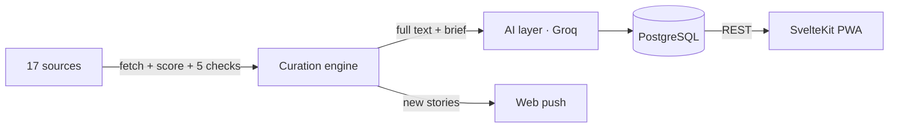

<div align="center">

<h1>Axon</h1>

<h3>You can't keep up with everything. You don't have to.</h3>

<p>The signal from the frontier of technology, without the noise.</p>


<sub>Recorded from the live landing page. The animation and stories are illustrative.</sub>

<p>
  <a href="https://axon-phi-ruby.vercel.app"><b>Open the feed →</b></a>
  &nbsp;·&nbsp;
  <a href="#how-the-filter-works">How the filter works</a>
  &nbsp;·&nbsp;
  <a href="#report-a-ranking-miss">Report a ranking miss</a>
  &nbsp;·&nbsp;
  <a href="CONTRIBUTING.md">Contribute</a>
</p>

<p>
  
  
  
</p>

</div>

---

Noise is the reposts, listicles and hype. Signal is what actually moved: a breakthrough, a launch, a repo people suddenly use.

Axon reads 17 sources across the AI labs, ArXiv, GitHub and Hacker News every 4 hours, scores every candidate, and admits at most 20 stories per sweep. Each one gets a brief written from the full article, its own chat, and a place in the weekly synthesis.

**The filter is open source.** Every rule that decides what reaches you is in this repo, so you can see why a story made the cut and argue with it when it shouldn't have.

## How the filter works

One score, then five checks. All of it lives in [`backend/engine/fetcher.py`](backend/engine/fetcher.py).

### 1. Score

```
score = w · (0.55 · e + 0.45 · r)
```

| Term | Meaning |
|---|---|
| **e** · Traction | The story's rank by points, stars or votes within its own source that sweep: 1 for the top, 0 for the bottom. That puts 300 Hacker News points and 3,000 GitHub stars on one scale. Sources without votes sit at 0.5. |
| **r** · Freshness | Exponential decay on a 72-hour scale. One day old scores 0.72, three days 0.37, a week 0.10. |
| **w** · Trust | A fixed weight per source, from 0.9 for news rewrites to 1.6 for OpenAI and Anthropic (`SOURCE_WEIGHTS`). |

### 2. Admit, in order

Candidates are sorted by score. Axon walks down the list and admits a story only if it passes all five checks, and stops at 20.

| # | Check | Rule |
|---|---|---|
| 01 | **New** | The link is not already in the feed. |
| 02 | **Recent** | Published in the last 30 days (`FRESHNESS_DAYS`). |
| 03 | **Not junk** | Not from a content farm (Medium, dev.to, LinkedIn…), and no fluff in the title: tutorials, roadmaps, career posts, awesome-lists. A high star count doesn't buy an exception. |
| 04 | **Not a repeat** | Two titles from different sources that share 60% or more of their key words are one story (`DEDUP_JACCARD`). The list is sorted, so the higher-scored copy is already in. |
| 05 | **Under quota** | At most 5 per source and 20 per sweep (`MAX_PER_SOURCE`, `MAX_TOTAL_PER_RUN`). Weaker sources drop out first. |

### 3. Brief

Each admitted story has its full text fetched and a brief written from it. The chat on a story answers from that article only.

### What that looks like

| Cut | Why |
|---|---|
| ~~15 prompts that will 10x your productivity~~ | Listicle |
| ~~My roadmap to becoming an AI engineer in 2026~~ | Career |
| ~~awesome-llm-resources~~ | Evergreen list |
| ~~The same model launch, reposted on four sites~~ | Duplicate ×4 |
| ~~This changes everything. Here is why.~~ | Hype |

| Kept | Why |
|---|---|
| **ArXiv** · Tool-use accuracy falls off a cliff past 40 tools | New result |
| **GitHub** · A voice agent that answers in under a second on a laptop | 2.1k stars in 6 days |
| **Anthropic** · Notes on how the new model handles long tasks | Primary source |
| **Hacker News** · What people actually ran on the small reasoning models | 412 points |

<sub>Illustrative examples. The live feed is at <a href="https://axon-phi-ruby.vercel.app">axon-phi-ruby.vercel.app</a>.</sub>

## Where it listens

| Channel | Sources |
|---|---|
| Hacker News | Front page, Ask and Show HN |
| GitHub | New repos gaining stars |
| ArXiv | cs.AI and cs.LG papers |
| AI labs | OpenAI, Anthropic, DeepMind, Google, Hugging Face, NVIDIA, Together |
| People | Simon Willison |
| Launches & news | Product Hunt, Lobsters, TechCrunch, The Verge, Ars Technica |

## What you get

- **Read** — a brief for every story, written from the full text rather than the headline: what changed, how it works, why it matters.
- **Ask** — every story has its own chat, grounded in that article, with suggested questions and voice input on supported phones.
- **Catch up** — a weekly synthesis of what moved: the big picture, the breakthroughs, and where builders should look next.
- **Install it** — a PWA with push notifications when a sweep lands new stories.

Free, no card: [open the feed](https://axon-phi-ruby.vercel.app/signup).

## Report a ranking miss

The filter will get things wrong. When it does, that's the most useful thing you can tell us.

[Open a ranking-miss issue](../../issues/new?template=ranking_miss.md) with the story, whether it should have been kept or cut, and which rule you think is at fault. Pull requests that change a rule should include a few real stories the change would have kept or dropped.

## What's open, and what isn't

| Open (in this repo) | Not published |
|---|---|
| Curation engine: sources, scoring, checks, dedupe, categories | The AI prompts used by the hosted product |
| AI pipeline: briefs, chat, weekly synthesis (with default prompts) | Production data, users, and keys |
| API (FastAPI) and app (SvelteKit PWA) | |

A clone runs the full pipeline. It uses the default prompts in [`backend/engine/prompts.py`](backend/engine/prompts.py), so its briefs are plainer than the hosted product's.

## Run it locally

```bash
git clone https://github.com/BemnetMussa/Axon.git
cd Axon

# App
cd fronted && npm install && cp .env.example .env && npm run dev

# API (separate terminal)
cd backend
python -m venv venv && source venv/bin/activate
pip install -r requirements.txt
cp .env.example .env
uvicorn app.main:app --reload --port 8000
```

You need PostgreSQL: put a `DATABASE_URL` (for example Supabase) in `.env`, or run `cd backend && docker compose up db -d` (Postgres on host port `5433`). Add a `GROQ_API_KEY` to `backend/.env` for briefs and chat; ingest works without it.

Trigger a sweep with `POST /ingest`, then `POST /analyze` to write the briefs.

### Tests

```bash
cd backend && pip install -r requirements-dev.txt && python -m pytest
cd fronted && npm test
```

## Architecture



| Path | What |
|---|---|
| `backend/engine/fetcher.py` | The filter: sources, scoring, checks, dedupe |
| `backend/engine/analyzer.py` | Briefs, chat, suggested questions, weekly synthesis |
| `backend/engine/prompts.py` | Default AI prompts |
| `backend/app/` | FastAPI routes, models, scheduler, engine loader |
| `fronted/` | SvelteKit 5 + Tailwind 4 app, Better Auth, web push |

More detail in [`backend/ARCHITECTURE.md`](backend/ARCHITECTURE.md).

## Self-hosting

Sweeps run on APScheduler inside the API process, so the API must stay up. `GET /health` reports scheduler state and the last ingest.

| Variable | Effect |
|---|---|
| `INGEST_INTERVAL_HOURS` | Hours between sweeps (default `4`) |
| `INGEST_RUN_ON_STARTUP` | Run one sweep when the API starts |
| `DISABLE_SCHEDULER` | Turn off APScheduler (use an external cron instead) |
| `AXON_FRONTEND_URL` | App URL the API calls to send push notifications after a sweep. Unset means no push. |

Optional Vercel cron: `GET /api/cron/ingest` with `CRON_SECRET` calls the API's `/ingest`. Don't run it alongside an always-on scheduler, or you'll sweep twice.

On a custom domain, update `BETTER_AUTH_URL`, the OAuth redirect URIs, and `CORS_ALLOWED_ORIGINS`.

Never commit `.env` files or keys.

## License

[AGPL-3.0](LICENSE). If you run a modified Axon as a service, you must share its source with your users. The Axon name and logo aren't licensed for forks; see [NOTICE](NOTICE).

Built by [Bemnet Mussa](https://x.com/BemnetMussa). Feedback and ranking arguments welcome there too.
