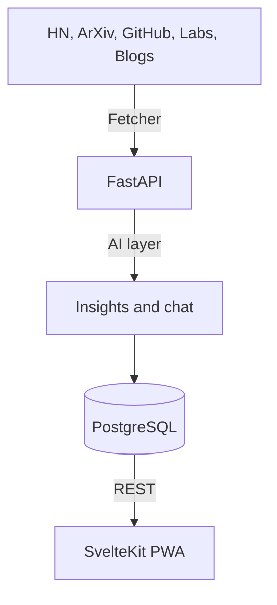

<div align="center">
  <h1>Axon</h1>
  <p><b>Catch up on AI — without drowning in it.</b></p>
  <p>Healthy Signals only. Open UI. Proprietary curation.</p>
  <p>
    <a href="https://axon-phi-ruby.vercel.app"><b>Live demo →</b></a>
    ·
    <a href="OPEN_CORE.md">Open-core</a>
    ·
    <a href="CONTRIBUTING.md">Contribute</a>
    ·
    <a href="SECURITY.md">Security</a>
  </p>
</div>

Axon is a builder-focused AI/tech signal reader: one place for ArXiv, Hacker News, GitHub, Product Hunt, lab blogs, and more — filtered into **Healthy Signals**, with insights and article-scoped chat on the hosted product.

## Open-core (what you get in this repo)

| Open (MIT) | Proprietary (not in git) |
|------------|---------------------------|
| SvelteKit UI / PWA | Curation engine (filters, ranking, dedup) |
| FastAPI API shell + models | AI analysis (prompts, insights, chat) |
| Community ingest/analyze stubs | Hosted accounts, sync, production feed |
| Docs & contributor guide | Admin ops / secrets |

Public clones boot with **stubs** (safe no-ops for ingest/AI). The [live demo](https://axon-phi-ruby.vercel.app) runs the full engine. Maintainers keep the engine in a local `private/services/` overlay (gitignored).

Details: [OPEN_CORE.md](OPEN_CORE.md) · [NOTICE](NOTICE) · [LICENSE](LICENSE)

## Why open this way

Big AI digests win on email list size. Thin aggregators ship feeds with little to contribute to. Axon opens the **product people can improve** (UI, a11y, docs, API shell) and keeps the **signal-quality moat** closed — so the community gets a real project to work on, and quality stays sharp.

## Architecture



- **Frontend:** SvelteKit 5, Tailwind CSS 4
- **Backend:** FastAPI, SQLModel, PostgreSQL
- **Hosted AI:** Groq-backed analysis (proprietary prompts)
- **Auth:** Better Auth

## Quick start (contributors)

```bash
git clone https://github.com/BemnetMussa/Axon.git
cd Axon

# UI
cd fronted && npm install && cp .env.example .env && npm run dev

# API shell (separate terminal)
cd backend
python -m venv venv && source venv/bin/activate
pip install -r requirements.txt
cp .env.example .env
uvicorn app.main:app --reload --port 8000
```

Without `private/services/`, `/ingest` and AI routes use community stubs — expected for OSS. Point the UI at the demo API if you only want to work on the client.

### Tests

```bash
cd backend && pip install -r requirements-dev.txt && python -m pytest
cd fronted && npm test
```

## Project structure

- `fronted/` — SvelteKit app (open)
- `backend/app/` — API shell; `*_community.py` stubs; loaders for private overlay
- `private/` — gitignored proprietary engine (maintainers only)
- `scripts/export-oss.sh` — clean tree export for a **new** public repo (no secrets, no history)

## Publishing note (maintainers)

This private GitHub repo’s **git history still contains** older proprietary engine commits. Do **not** flip visibility to public without either:

1. Creating a **new** public repo from `scripts/export-oss.sh`, or
2. Scrubbing history (`git filter-repo`) before going public

Never commit `.env`, keys, or `private/services/`.

## Support & feedback

- Demo: [axon-phi-ruby.vercel.app](https://axon-phi-ruby.vercel.app)
- Issues: use GitHub Issues for open-package bugs
- Product chat: [@BemnetMussa](https://x.com/BemnetMussa)

## License

MIT for the open package. Proprietary boundary in [NOTICE](NOTICE).

---

### Ops notes (self-host / always-on API)

**Scheduler:** Auto-ingestion uses APScheduler inside the API process. It only runs while that process is continuously up. Set `INGEST_INTERVAL_HOURS` (default `4`).

**Health:** `GET /health` exposes scheduler / last ingest fields.

| Variable | Effect |
|----------|--------|
| `INGEST_INTERVAL_HOURS` | Hours between scheduled runs (default `4`) |
| `INGEST_RUN_ON_STARTUP` | Queue one ingest on API start |
| `DISABLE_SCHEDULER` | Disable APScheduler (external cron only) |

**Vercel cron:** Optional `GET /api/cron/ingest` with `CRON_SECRET` → hosted FastAPI `/ingest`. Avoid double ingest if APScheduler is already always-on.

**Custom domain:** Update `BETTER_AUTH_URL`, OAuth redirect URIs, and `CORS_ALLOWED_ORIGINS`.

### Database

- Supabase URI in `.env` as `DATABASE_URL`, or
- `cd backend && docker compose up db -d` (Postgres on host port `5433`)

### Full local engine (maintainers)

```bash
# Overlay (gitignored) — restore from Axon-proprietary backup if needed
ls private/services/fetcher.py private/services/analyzer.py
```

Then `POST /ingest` and `POST /analyze` behave as the production pipeline.
