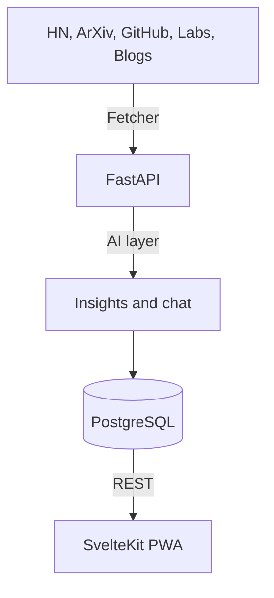

<div align="center">
  <h1>Axon</h1>
  <p><b>Catch up on AI — without drowning in it.</b></p>
  <p>Healthy Signals only. Open source, algorithm included.</p>
  <p>
    <a href="https://axon-phi-ruby.vercel.app"><b>Live demo →</b></a>
    ·
    <a href="CONTRIBUTING.md">Contribute</a>
    ·
    <a href="SECURITY.md">Security</a>
  </p>
</div>

Axon is a builder-focused AI/tech signal reader: one place for ArXiv, Hacker News, GitHub, Product Hunt, lab blogs, and more — filtered into **Healthy Signals**, with insights and article-scoped chat on the hosted product.

## What's in this repo

Everything that decides what you see:

- **Curation engine** — `backend/engine/fetcher.py`: sources, freshness gate, scoring, near-duplicate detection, per-source caps, categories
- **AI analysis** — `backend/engine/analyzer.py`: insights, briefs, digests, and article chat. The repo ships default prompts in `backend/engine/prompts.py`; the hosted product uses its own, which aren't published.
- **API** — `backend/app/` (FastAPI, SQLModel, PostgreSQL)
- **App** — `fronted/` (SvelteKit PWA, push notifications)

## Why open the algorithm

Axon's job is to filter the noise. A filter you can't inspect is just another opinion. Here you can read exactly why a story made the cut, and propose a better rule when it gets one wrong.

## Architecture



- **Frontend:** SvelteKit 5, Tailwind CSS 4
- **Backend:** FastAPI, SQLModel, PostgreSQL
- **AI:** Groq-backed analysis
- **Auth:** Better Auth

## Quick start (contributors)

```bash
git clone https://github.com/BemnetMussa/Axon.git
cd Axon

# UI
cd fronted && npm install && cp .env.example .env && npm run dev

# API (separate terminal)
cd backend
python -m venv venv && source venv/bin/activate
pip install -r requirements.txt
cp .env.example .env
uvicorn app.main:app --reload --port 8000
```

Add a `GROQ_API_KEY` to `backend/.env` for AI insights; ingest works without it.

### Tests

```bash
cd backend && pip install -r requirements-dev.txt && python -m pytest
cd fronted && npm test
```

## Project structure

- `fronted/` — SvelteKit app
- `backend/app/` — FastAPI routes, models, engine loader
- `backend/engine/` — curation engine + AI analysis
- `private/services/` — optional gitignored local override of the engine (see `private/README.md`)

Never commit `.env` files or keys.

## Support & feedback

- Demo: [axon-phi-ruby.vercel.app](https://axon-phi-ruby.vercel.app)
- Issues: use GitHub Issues for bugs and ranking misses
- Product chat: [@BemnetMussa](https://x.com/BemnetMussa)

## License

[AGPL-3.0](LICENSE). If you host a modified Axon, you must share your source with its users. The Axon name is not licensed for forks — see [NOTICE](NOTICE).

---

### Ops notes (self-host / always-on API)

**Scheduler:** Auto-ingestion uses APScheduler inside the API process. It only runs while that process is continuously up. Set `INGEST_INTERVAL_HOURS` (default `4`).

**Health:** `GET /health` exposes scheduler / last ingest fields.

| Variable | Effect |
|----------|--------|
| `INGEST_INTERVAL_HOURS` | Hours between scheduled runs (default `4`) |
| `INGEST_RUN_ON_STARTUP` | Queue one ingest on API start |
| `DISABLE_SCHEDULER` | Disable APScheduler (external cron only) |

**Vercel cron:** Optional `GET /api/cron/ingest` with `CRON_SECRET` → hosted FastAPI `/ingest`. Avoid double ingest if APScheduler is already always-on.

**Custom domain:** Update `BETTER_AUTH_URL`, OAuth redirect URIs, and `CORS_ALLOWED_ORIGINS`.

### Database

- Supabase URI in `.env` as `DATABASE_URL`, or
- `cd backend && docker compose up db -d` (Postgres on host port `5433`)
